# AML Case Reporter

**AI-assisted investigation reports for Anti-Money Laundering (AML) alerts — a portfolio prototype.**


AML Case Reporter takes a transaction flagged as suspicious, together with the customer's master data and the full history of their accounts and cards, and produces a structured **Word investigation report** for the AML team. A Large Language Model reads the unstructured parts of the data, such as free-text wire transfer descriptions, and turns them into structured fields: IBAN, counterparty name, counterparty type. Deterministic Python analytics then compute every figure and red flag from those fields. The analyst reads one document instead of querying five systems, and decides faster whether to **escalate** the alert or **close** it as a false positive.

---

> [!IMPORTANT]
> ### Disclaimer — everything in this repository is fictional
>
> - **Independent personal project.** This repository is a portfolio piece built by the author in their own time. It is **not affiliated with, endorsed by, sponsored by, or derived from** any bank, financial institution, employer, or client, and none is named or referenced.
> - **No proprietary material.** The author has worked on similar problems professionally. This repository contains **none** of that work: no source code, data, configuration, business rules, thresholds, scoring logic, prompts, report templates, transaction description formats, internal codes, system names, or documentation belonging to any current or former employer or client has been used, copied, or adapted. **All code was written from scratch for this repository.**
> - **Public knowledge only.** Domain concepts (alert triage, red-flag typologies, customer due diligence) come exclusively from publicly available sources — see [References](#references).
> - **100% synthetic data.** Every customer, company, account, card, transaction, and alert is randomly generated. Any resemblance to real persons, companies, or accounts is purely coincidental. Identifiers are invalid by construction, so they cannot match real ones (see [Privacy by design](#privacy-by-design)).
> - **Not a compliance tool.** Rules and thresholds are illustrative and unvalidated. Do not use this software to make real AML decisions. Nothing here is legal or regulatory advice.

---

## Table of contents

- [Why this project](#why-this-project)
- [What it does](#what-it-does)
- [How it works](#how-it-works)
- [LLM tasks](#llm-tasks)
- [Red-flag rules](#red-flag-rules)
- [The report](#the-report)
- [Synthetic data](#synthetic-data)
- [LLM integration](#llm-integration)
- [Privacy by design](#privacy-by-design)
- [Evaluation](#evaluation)
- [Tech stack](#tech-stack)
- [Project structure](#project-structure)
- [Quickstart](#quickstart)
- [Development](#development)
- [Roadmap](#roadmap)
- [Limitations](#limitations)
- [References](#references)
- [License](#license)

## Why this project

Transaction-monitoring systems raise alerts on activity that matches predefined risk scenarios. Each alert must be investigated by an analyst, who has to:

1. collect the customer's KYC profile, accounts, cards, and transaction history from several systems;
2. analyse behaviour, counterparties, geography, and consistency with the declared profile;
3. write up the findings;
4. decide whether to escalate the case (towards a suspicious transaction report to the Financial Intelligence Unit) or close it as a false positive.

A large share of alerts turn out to be false positives, yet each one costs the same manual effort. Much of that effort goes into reading free-text fields: who actually sent this transfer, from which account, is it a person or a company? This prototype automates that reading with an LLM and assembles a complete, explainable case file in minutes, so analysts spend their time on judgement instead of data gathering.

As a portfolio piece, the project shows how to use an LLM where it adds value in a **regulated domain**: narrow and measurable extraction and classification tasks, validated outputs, deterministic reasoning, privacy, and human oversight.

## What it does

| | Description |
|---|---|
| **Input** | A *case bundle* (JSON): the alerted transaction and the scenario that triggered it; the customer's master data (individual or business, occupation or sector, declared income or turnover, risk rating, onboarding date, residence); the linked current accounts and cards; the full transaction history of those accounts and cards over a look-back window, including free-text descriptions. |
| **Output** | A `.docx` investigation report, plus a JSON **fact sheet** that records every computed value and the transactions behind it (audit trail). |
| **Decision** | Always taken by a human analyst. The report presents evidence, red flags, and a risk indicator; it never closes or escalates an alert on its own. |

## How it works

```mermaid
flowchart LR
    A["Case bundle<br/>alert + KYC + accounts + transactions"] --> B["Ingestion and validation"]
    B --> C["LLM enrichment<br/>extraction and classification"]
    C --> D["Output validation"]
    D --> E["Enriched transactions"]
    E --> F["Analytics engine<br/>deterministic Python"]
    F --> G["Red-flag rules<br/>config-driven"]
    F --> H["Fact sheet<br/>JSON with traceable IDs"]
    G --> H
    H --> I["Report builder<br/>python-docx"]
    I --> J["DOCX report"]
    J --> K{"AML analyst"}
    K -->|escalate| L["Further investigation"]
    K -->|close| M["False positive"]
```



The core design rule is **"the LLM reads, Python reasons"**.

1. **LLM enrichment.** Transaction records contain free text that rules handle poorly: formats vary, labels are abbreviated or missing, field order changes. The LLM performs narrow extraction and classification tasks on that text and returns schema-constrained fields.
2. **Output validation.** Every LLM answer is checked before use. Labels must belong to a closed set; extracted strings such as IBANs and names must appear verbatim in the source text, so the model cannot invent them; IBANs must have a valid structure. Abstaining (`null`, or `unknown` for the payment purpose) is an accepted answer, because it is better than guessing. Items that fail validation fall back to a rule-based extractor, and the report appendix counts how many did.
3. **Deterministic analytics.** Python computes every aggregate, ratio, chart, and red flag on the enriched transactions. Each result becomes a *fact* with a stable ID and the list of transactions that support it.
4. **Templated report.** The report text is built from templates filled with facts. There is no free-form generated prose, so every sentence can be traced back to the data.
5. **Human in the loop.** The final decision fields are left blank for the analyst.

## LLM tasks

| Task | Input | Output |
|---|---|---|
| IBAN extraction | Wire transfer description | Counterparty IBAN, or `null` |
| Counterparty extraction | Wire transfer description | Counterparty name, or `null` |
| Counterparty type | Counterparty name | `natural_person` or `legal_person` |
| Payment purpose | Wire transfer description | `salary`, `rent`, `invoice`, `loan`, `family_support`, `other`, or `unknown` |

Each task is a prompt file plus an output schema, evaluated on its own; new tasks can be added the same way.

Example input (synthetic):

```text
BONIF. SEPA DA ACME LOGISTICA SRL IBAN IT00X9999901234000000123456 CAUS. SALDO FATT. 112
```

Enriched output:

```json
{
  "transaction_id": "TX-000812",
  "counterparty_name": "ACME LOGISTICA SRL",
  "counterparty_iban": "IT00X9999901234000000123456",
  "counterparty_type": "legal_person",
  "payment_purpose": "invoice",
  "source": "llm"
}
```

These fields feed the analytics: counterparties are grouped by name and IBAN, split into natural and legal persons, and mapped to countries through the IBAN country code.

**Why not just regular expressions?** A rule-based extractor is included as a baseline. It works on well-formed descriptions but breaks on abbreviations, missing labels, swapped field order, and typos. The [evaluation](#evaluation) measures exactly how much the LLM adds over it.

## Red-flag rules

About 70 facts per case feed a small set of transparent rules, defined in [`rules.toml`](src/aml_reporter/rules/rules.toml). Each rule compares facts with a threshold; when all its conditions hold, it raises a red flag that cites those facts and their transactions.

| Rule | Looks for | Severity |
|---|---|---|
| `RF-STRUCTURING` | Several recent cash deposits just below a threshold | high |
| `RF-PASS-THROUGH` | Money from many different people, with outflows at least twice the usual level | high |
| `RF-DORMANT-REACTIVATION` | The alert follows 90+ days without customer activity | high |
| `RF-FOREIGN-INFLOWS` | Large inflows from foreign accounts | medium |
| `RF-CASH-WITHDRAWALS` | Large recent cash withdrawals | medium |
| `RF-PROFILE-MISMATCH` | Salary or invoice inflows at 3× the declared income or turnover | medium |
| `RF-OUTFLOW-SPIKE` | Recent outflows at least twice the usual level | low |

The risk indicator is a plain sum: 1, 2, or 3 points per flag by severity; 2 points or more is medium, 3 or more is high. No machine-learned score, so every level can be explained flag by flag. Thresholds are illustrative and invented for the synthetic scenarios.

## The report

| # | Section | Content | LLM contribution |
|---|---|---|---|
| 1 | Cover and case summary | Case ID, alert date, triggering scenario, generation metadata, disclaimer | — |
| 2 | Key findings | Triggered red flags and overall risk indicator | — |
| 3 | Alert in context | The alerted transaction compared with the customer's own baseline | Counterparty and type of the alerted transaction |
| 4 | Customer profile | KYC data, risk rating, tenure, declared economic profile | — |
| 5 | Relationship overview | Accounts and cards, status, opening dates, balances | — |
| 6 | Transaction behaviour | Monthly inflows and outflows, channels, cash share, payment purpose mix, charts | Payment purpose |
| 7 | Counterparty analysis | Top and new counterparties, concentration, natural vs legal persons, recurring vs one-off | Counterparty name, IBAN, type |
| 8 | Geographic exposure | Countries derived from counterparty IBANs, and flows with foreign accounts | IBAN |
| 9 | Red flags and typologies | Triggered rules with evidence (e.g. structuring, pass-through of funds, dormant account reactivation) | Indirect: rules use enriched fields |
| 10 | Profile consistency | Declared income or turnover vs observed flows by purpose | Payment purpose |
| 11 | Analyst assessment | Blank fields for the decision (escalate / close / request more information) and notes | — |
| 12 | Appendix | Methodology, data lineage, enrichment statistics (LLM vs fallback), limitations | — |

The analysis catalogue is being expanded; the detailed specification of each analysis will live in [`docs/`](docs/).

## Synthetic data

### Scenarios

The generator produces case bundles from scenario templates. Each scenario carries an **expected outcome**, used as ground truth for the red flags and the risk indicator.

| Scenario | Story | Expected outcome |
|---|---|---|
| `fp_salary_bonus` | An employee receives a one-off annual bonus that triggers an amount-based alert | Close |
| `fp_property_sale` | A large inflow consistent with the sale of a property | Close |
| `structuring_cash` | Repeated cash deposits just below an illustrative threshold | Escalate |
| `pass_through` | Many incoming transfers from unrelated natural persons, quickly wired abroad | Escalate |
| `dormant_reactivation` | A long-dormant account suddenly moves large amounts | Escalate |
| `profile_mismatch` | A small sole trader whose turnover far exceeds the declared one | Request more information |

### Transaction descriptions

Wire transfer descriptions are written from a set of invented templates, with realistic noise: abbreviations, truncation, typos, varying field order, missing IBANs. Because the generator knows the true IBAN, counterparty, type, and purpose behind every description, it also produces a **labelled dataset** for evaluating the LLM tasks. Labels are stored apart from the case bundles, so the pipeline never sees them.

## LLM integration

Enrichment sits behind a small interface, so the same pipeline runs with different backends, listed in order of preference:

| Enricher | Purpose |
|---|---|
| `local` (default) | An open-weight model served locally via Ollama (default `llama3.1:8b`, configurable). In banking deployments of this kind, the LLM runs on the institution's own servers; this backend reproduces that architecture. |
| `anthropic` | Claude through the official Anthropic Python SDK (default model `claude-haiku-5-5`, fast and inexpensive, configurable), with structured outputs based on Pydantic schemas and low effort for these narrow tasks. |
| `baseline` | Rule-based extractor, no LLM. Runs offline; used in CI, as the fallback for failed validations, and as the evaluation baseline. |

Prompt design:

- one versioned prompt file per task in [`src/aml_reporter/enrichment/prompts/`](src/aml_reporter/enrichment/prompts/), not strings buried in code;
- few-shot examples made of invented data only;
- closed label sets, and an explicit instruction to answer `unknown` or `null` instead of guessing;
- up to 20 inputs per request, and a cache keyed on the normalised description, since the same descriptions recur (salary, rent, utilities).

Failure handling: API errors, timeouts, refusals, malformed JSON, missing answers, and values that fail validation never stop the pipeline. The affected transaction is enriched by the baseline instead, and its `source` says so.

## Privacy by design

Even though all data is synthetic, the pipeline is designed as it would be for real data.

- **Synthetic only.** A seeded generator builds every case from scenario templates, using only very common Italian first names and surnames (so no generated person points to a recognisable individual) and deliberately fictitious street names.
- **Invalid-by-construction identifiers.** IBANs use check digits `00`, which no real IBAN can have, fail the mod-97 checksum, and carry a fictitious bank code; fiscal codes (*codice fiscale*) carry a wrong control character; VAT numbers have a wrong check digit; card numbers fail the Luhn check and are only ever stored masked. Tests enforce every rule.
- **LLM inside the perimeter.** With real data, the model must run on infrastructure controlled by the institution, so customer data never leaves its perimeter. The `local` backend shows this setup end to end.
- **Data minimisation.** Each LLM call receives only the text its task needs (a transaction description or a counterparty name), never the customer profile or the account history.
- **No secrets in the repo.** `.env` is git-ignored, `.env.example` documents the variables, and CI runs a secret scanner.
- **Clean outputs.** Generated reports go to a git-ignored `output/` folder. DOCX metadata (author, company) is set explicitly so no machine or organisation details leak into files.
- **Quiet logging.** Prompt and response bodies are not logged by default.

These measures follow privacy-by-design principles such as those in GDPR Article 25. They are an engineering demonstration, not a legal compliance assessment.

## Evaluation

The synthetic generator provides ground-truth labels, so LLM quality is measured, not assumed:

- **Extraction:** exact-match accuracy for IBANs and counterparty names, after normalisation.
- **Classification:** precision, recall, F1, and confusion matrix for counterparty type and payment purpose.
- **Abstention and invention:** share of `null` and `unknown` answers, and share of extracted values not found in the source text (blocked by validation, but still measured).
- **Baseline comparison:** every metric for `baseline`, `local`, and `anthropic`, on the full dataset and on a *hard* subset (typos, abbreviations, missing labels).
- **End to end:** expected red flags per scenario, and risk indicator vs expected outcome.
- **Tests:** unit tests for every analyser, rule, and validator; golden tests on fact sheets.

Results will be published in `docs/evaluation.md`.

## Tech stack

| Area | Tools |
|---|---|
| Language and packaging | Python 3.12+, [uv](https://docs.astral.sh/uv/) |
| Data and validation | Pydantic v2; analytics in plain Python with exact decimals |
| Synthetic data | Seeded Python generator, no external data |
| LLM | Anthropic Python SDK, httpx (Ollama) |
| Report | python-docx, matplotlib |
| Evaluation | scikit-learn (metrics) |
| CLI | Typer |
| Quality | pytest, ruff, mypy, pre-commit, gitleaks |
| CI | GitHub Actions |

## Project structure

Planned layout (built incrementally, see the [implementation plan](docs/implementation-plan.md)):

```text
aml-prototype/
├── README.md
├── LICENSE
├── pyproject.toml
├── .env.example
├── data/
│   ├── samples/                # Synthetic case bundles (generated)
│   └── labels/                 # Ground-truth labels for evaluation (generated)
├── examples/                   # Sample reports generated from synthetic data
├── docs/                       # Technical documentation
├── src/aml_reporter/
│   ├── models/                 # Pydantic domain schemas
│   ├── synthetic/              # Synthetic data, descriptions, and labels
│   ├── ingestion/              # Case bundle loading and validation
│   ├── enrichment/             # LLM tasks, prompts, output validation, rule-based baseline
│   ├── llm/                    # Backend clients (local, anthropic)
│   ├── analytics/              # One module per analysis
│   ├── rules/                  # Red-flag rule engine and illustrative rules (rules.toml)
│   ├── report/                 # DOCX builder, sections, charts
│   ├── evaluation/             # Metrics against ground-truth labels
│   └── cli.py
└── tests/
```

## Quickstart

Available now:

```bash
git clone https://github.com/<your-username>/aml-prototype.git
cd aml-prototype
uv sync

# Generate the synthetic case bundles and labels
uv run aml-report synth --scenario all --seed 42

# Enrich a case with the default backend, a local model served by Ollama
ollama pull llama3.1:8b
uv run aml-report enrich data/samples/pass_through.json --limit 10

# Or with Claude
cp .env.example .env   # then set ANTHROPIC_API_KEY
uv run aml-report enrich data/samples/pass_through.json --enricher anthropic --limit 10

# Or fully offline, with the rule-based baseline
uv run aml-report enrich data/samples/pass_through.json --enricher baseline

# Compute the fact sheet: every figure the report will cite, with its evidence
uv run aml-report analyze data/samples/structuring_cash.json --output output/facts.json

# Raise the red flags and compute the risk indicator
uv run aml-report assess data/samples/structuring_cash.json
```

Target interface, available once the later phases of the implementation plan are complete:

```bash
# Build a report offline with the rule-based baseline, no LLM needed
uv run aml-report generate data/samples/structuring_cash.json --enricher baseline

# Build a report with a local model (requires Ollama)
uv run aml-report generate data/samples/structuring_cash.json --enricher local

# Build a report with Claude, in Italian
uv run aml-report generate data/samples/structuring_cash.json --enricher anthropic --lang it

# Compare enrichers on the labelled synthetic dataset
uv run aml-report evaluate --enricher baseline --enricher local
```

## Development

```bash
uv sync                      # Create the virtual environment with dev tools
uv run pre-commit install    # Run ruff, mypy, and gitleaks on every commit
uv run pytest                # Run the test suite, offline
uv run pytest -m integration # Smoke-test the configured LLM backends
```

CI runs the same hooks on all files, the test suite, and a secret scan of the full git history.

## Roadmap

Development follows the phases in [`docs/implementation-plan.md`](docs/implementation-plan.md): repository foundation → domain model → synthetic data → LLM enrichment → analytics → rules → report builder → CLI and examples → evaluation → documentation.

## Limitations

- A prototype for demonstration, not a production system.
- Rules and thresholds are illustrative, and no real jurisdiction is designated as high risk.
- Sanctions screening, adverse-media search, and PEP list matching are out of scope.
- Validation blocks invented values, but not every LLM error: a real name can still be assigned to the wrong role (payer instead of beneficiary). A human must always review the report.
- Synthetic descriptions cannot capture the full variety of real-world formats; real performance would need to be measured on real, properly governed data.

## References

Public sources used for domain concepts:

- [FATF — Financial Action Task Force](https://www.fatf-gafi.org/): Recommendations and money-laundering typology reports.
- [EUR-Lex](https://eur-lex.europa.eu/): Directive (EU) 2015/849 and Regulation (EU) 2024/1624 (EU AML framework).
- [Normattiva](https://www.normattiva.it/): Italian Legislative Decree 231/2007 on AML.
- [UIF — Italian Financial Intelligence Unit](https://uif.bancaditalia.it/): public anomaly indicators and patterns of anomalous behaviour.
- [The Wolfsberg Group](https://www.wolfsberg-group.org/): public guidance on transaction monitoring.

## License

Released under the [MIT License](LICENSE).
